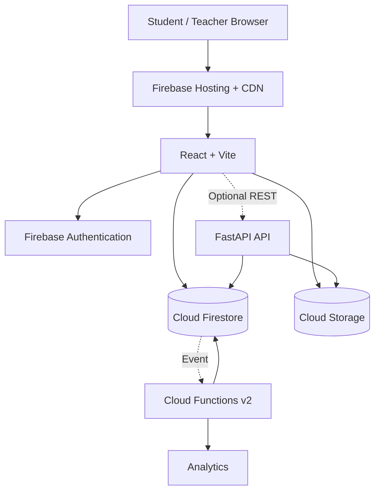

# Cloud-Based Student Assignment Submission & Feedback Portal

A GitHub-ready cloud computing project for digital assignment submission, grading and feedback. The core implementation uses **React + Vite + Firebase Authentication + Cloud Firestore + Cloud Storage + Firebase Hosting**, with an optional **FastAPI REST API**, optional **Firebase Cloud Functions v2** processing layer, and optional **AI similarity/grade-assistance service**.

> **Student project focus:** the application is deliberately designed to demonstrate cloud computing concepts—not just CRUD. It shows managed authentication, RBAC, cloud database, object storage, private file paths, REST APIs, serverless processing, scalability patterns, security rules, local emulation, testing, deployment and GitHub proof.

## Overview

Teachers create assignments and deadlines. Students authenticate, view coursework, upload assignment files, resubmit versions, and view their status/feedback. Teachers review submissions, download/open files, assign marks and return comments.

## Architecture



Firebase Hosting is backed by a global CDN and HTTPS/SSL. Firebase Authentication supports email/password authentication. Firebase documents Security Rules as the authorization layer for web/mobile client libraries, and Cloud Storage supports Security Rules for file read/write and metadata validation. citeturn415101search4turn415101search0turn196755search3turn196755search1

## Problem statement

Paper submissions, email attachments and manually tracked feedback can scatter assignment files, deadlines, grades and comments. The proposed portal creates one cloud-accessible workflow where metadata and files are centrally managed.

## Objectives

- Provide student and teacher dashboards.
- Support assignment CRUD and deadline management.
- Upload PDF/DOCX/JPG/PNG files up to a configurable limit.
- Track multiple submission versions.
- Store file binaries in object storage and metadata in a cloud database.
- Enforce authentication and role-based authorization.
- Provide teacher grading and feedback.
- Demonstrate REST APIs, serverless/event-driven processing and deployment.
- Provide local no-cost emulation and reproducible GitHub proof.

## Features

### Student

- Register/login/logout
- View assignments and deadlines
- Upload assignment
- Resubmit with version history
- View submission status
- View marks and feedback
- View previously uploaded files

### Teacher

- Login
- Create course
- Create/delete assignments
- Set deadlines, marks and file limits
- View course submissions
- Open submitted files
- Grade and comment
- View upload/deadline statistics

### Admin concept

The data model supports an `admin` role for user/course management. Public registration never creates a teacher/admin account.

## Cloud computing concepts demonstrated

| Concept | Implementation |
|---|---|
| Cloud Computing | Firebase-managed hosted portal |
| SaaS | Browser-consumed assignment service |
| PaaS | Firebase managed services |
| IaaS | Advanced AWS/Azure/GCP mapping in docs |
| Cloud Database | Firestore |
| Object Storage | Firebase Storage |
| Authentication | Firebase Auth |
| Authorization | Firestore + Storage Security Rules |
| RBAC | Student / Teacher / Admin |
| REST | Optional FastAPI service |
| Serverless | Optional Cloud Functions v2 |
| Scalability | Managed services + optional autoscaling/serverless patterns |
| CDN | Firebase Hosting |
| Secrets | `.env`, service account kept out of Git |
| Logging | Function logger / platform logging |
| Monitoring | Firebase/GCP console + optional alerts |
| CI/CD | GitHub Actions workflow |
| Backup | Production backup/export strategy documented |
| Deployment | Firebase Hosting, optional Functions/API/AI container |

## Database design

The implementation uses root-level collections because the student dashboard and reporting flows need cross-course queries. The source design also describes a nested course/assignment schema; this repository chooses root-level assignments with explicit `courseId` and `teacherId` so query authorization can be aligned with Firestore Rules.

```text
users/{userId}
courses/{courseId}
assignments/{assignmentId}
submissions/{submissionId}
analytics/{courseId_assignmentId}
```

See `docs/database_design.md`.

## Storage design

```text
assignments/
  {assignmentId}/
    {studentId}/
      {randomId}-{sanitizedFileName}
```

The file lives in Storage; `submissions/{id}` stores `fileName`, `fileUrl`, `storagePath`, timestamp, status, version, marks and feedback. Cloud Storage Security Rules validate authentication, path ownership, content type and size. citeturn415101search7turn196755search1

## Authentication and authorization

Firebase Auth identifies the user. The Firestore `users/{uid}` profile holds the project role. Student public registration writes only the `student` role. Teachers/admins are provisioned through an authorized process or the dummy seed script.

The browser's protected routes are only a UI convenience; the actual authorization boundary is the Firestore/Storage Security Rules.

## Local setup — no paid cloud required

Firebase Local Emulator Suite supports local authentication, Firestore and Storage emulation. Current Firebase documentation lists Node.js and Java requirements; for a fresh setup, use a current Node release and JDK 21. citeturn368546search0turn368546search3

### Install

```powershell
npm install
npm run install:frontend
npm run install:functions
npm install -g firebase-tools
```

### Start emulators

```powershell
firebase emulators:start --project demo-cloud-assignment
```

### Configure frontend

```powershell
Copy-Item frontend\.env.example frontend\.env
```

Set `VITE_USE_FIREBASE_EMULATORS=true` and the demo values shown in `docs/local_setup.md`.

### Seed dummy data

```powershell
npm run seed:emulator
```

### Start the app

```powershell
npm run dev
```

Open `http://localhost:5173`.

Demo accounts:

```text
Teacher: teacher.demo@example.com / DemoTeacher123!
Student: student.demo@example.com / DemoStudent123!
```

These are dummy project credentials only.

## Cloud deployment — free-tier core

The core Firebase path uses Authentication, Firestore, Storage and Hosting. Firebase currently lists a no-cost Spark plan, while Cloud Functions is listed under the pay-as-you-go plan. Therefore Functions are optional in this repository. citeturn415101search5

### Firebase setup

1. Create a Firebase project.
2. Add a Web App.
3. Enable Email/Password Authentication.
4. Create Firestore Database.
5. Enable Cloud Storage.
6. Set the frontend `.env` values from the Web App configuration.
7. Connect the repository with `firebase use --add`.

Deploy:

```powershell
npm run build
firebase deploy --only firestore:rules,firestore:indexes,storage,hosting
```

Firebase documents the CLI Hosting deployment flow and the provisioned `web.app` / `firebaseapp.com` sites. citeturn415101search4

## Optional REST backend deployment

The FastAPI backend can run locally:

```powershell
cd backend
python -m venv .venv
.\.venv\Scripts\Activate.ps1
pip install -r requirements.txt
Copy-Item .env.example .env
uvicorn app:app --reload --port 8000
```

For managed container deployment, use `backend/Dockerfile` with a suitable provider such as Cloud Run. This path can require billing and is not needed for the free-tier Firebase core.

## Optional Firebase Functions

The `functions/` directory contains 2nd generation Firestore processing for server-side deadline classification, version numbering and daily analytics. Firebase's current documentation uses modular v2 triggers such as `onDocumentCreated`; server-side functions run with Admin SDK privileges and are not constrained by client Firestore Rules. citeturn501699search0

Deploy only when your billing/plan supports it:

```powershell
npm run deploy:functions
```

## Optional AI extension

`ai_service/` demonstrates:

- Sentence-BERT semantic similarity against a reference corpus.
- TF-IDF + Ridge grade suggestion using dummy graded examples.

Run:

```powershell
cd ai_service
python -m venv .venv
.\.venv\Scripts\Activate.ps1
pip install -r requirements.txt
python train_grade_model.py
uvicorn app:app --reload --port 8001
```

AI output is explicitly a teacher-assistance signal, not the final grade.

## REST endpoints

See `docs/api.md`. Examples include:

```text
GET  /api/me
POST /api/assignments
GET  /api/assignments
GET  /api/assignments/{id}
PUT  /api/assignments/{id}
DELETE /api/assignments/{id}
POST /api/assignments/{id}/submit
GET  /api/submissions/me
GET  /api/assignments/{id}/submissions
GET  /api/submissions/{id}
POST /api/submissions/{id}/grade
GET  /api/submissions/{id}/feedback
GET  /api/submissions/{id}/download
```

Protected REST requests require a Firebase ID token in `Authorization: Bearer <TOKEN>`.

## Folder structure

```text
Cloud-Based-Assignment-Submission-Portal/
├── frontend/
│   ├── src/
│   │   ├── components/
│   │   ├── pages/
│   │   ├── services/
│   │   ├── utils/
│   │   ├── context.jsx
│   │   ├── firebase.js
│   │   ├── App.jsx
│   │   └── main.jsx
│   ├── package.json
│   └── .env.example
├── backend/
│   ├── app.py
│   ├── requirements.txt
│   └── Dockerfile
├── functions/
│   ├── src/index.js
│   └── package.json
├── ai_service/
│   ├── app.py
│   ├── train_grade_model.py
│   └── Dockerfile
├── rules/
│   ├── firestore.rules
│   ├── firestore.indexes.json
│   └── storage.rules
├── scripts/
│   ├── seed-demo.js
│   └── seed-emulator.js
├── sample_files/
├── tests/
├── docs/
├── reports/
├── screenshots/
├── firebase.json
├── package.json
├── requirements.txt
└── README.md
```

## Testing

```powershell
npm test
```

The repository includes deterministic unit tests for deadline logic and file validation. `docs/testing.md` contains the full 25-case manual matrix. For production-grade Rules validation, add Local Emulator Suite rule tests before deployment. Firebase explicitly recommends testing Security Rules with the Emulator Suite and using those tests in CI. citeturn196755search6turn196755search2

## Security highlights

- No hardcoded passwords/API secrets in application code.
- Student self-registration cannot choose teacher/admin.
- Firestore rules enforce role/ownership.
- Storage path includes assignment + student identity.
- MIME type and size are checked on the client and Storage Rules.
- Students cannot update marks/feedback/status.
- Teacher access is scoped to owned course/submission data.
- Optional FastAPI validates Firebase ID tokens and can return short-lived signed URLs.

## Scalability

For small demos, managed Firebase services are enough. For larger workloads, use CDN-delivered frontend assets, direct object-storage uploads, stateless autoscaling APIs/serverless workers, managed database indexing, queues, caching, asynchronous analytics and monitoring. See `docs/scalability.md`.

## Failure handling

See `docs/failure_handling.md` for upload retry, token expiry, backend failure, database/storage failures and idempotency design.

## GitHub proof

Recommended repository description:

> Cloud-based student assignment submission and feedback platform featuring role-based authentication, cloud database integration, object storage, assignment management, secure file submission, grading, feedback workflows and scalable cloud architecture.

Suggested topics:

`cloud-computing` `edtech` `firebase` `react` `vite` `python` `fastapi` `firestore` `cloud-storage` `rest-api` `authentication` `full-stack` `devops`

## Commit strategy

Use the commit sequence in `docs/github_strategy.md` so your history visibly documents the implementation lifecycle.

## Screenshots

Use the 27 filenames in `docs/screenshot_checklist.md`. Never upload credentials or real student data as screenshots.

## Limitations

- The core UI uses Firebase browser download URLs for the simplest Firebase-only demo; the optional REST layer shows the stricter short-lived signed URL pattern.
- Functions are optional because current Firebase pricing lists them under the pay-as-you-go plan. citeturn415101search5
- The AI extension is a demonstration and does not replace teacher judgment.
- Production deployments need stronger backup, monitoring, audit logging, malware scanning and retention policies than this student-sized implementation.

## Future improvements

- Email/push deadline reminders
- Rubric-based grading
- Dedicated immutable audit log
- Malware scanning/quarantine
- App Check and rate limiting
- Notification queue/background workers
- Bulk grade export
- Full mobile client using the REST API
- CI/CD deployment to staging/production
- Automated backup/disaster recovery
- AI-assisted feedback with human review

## Learning outcomes

This project demonstrates practical understanding of cloud service composition, serverless concepts, managed databases, object storage, authentication, authorization, REST APIs, deployment, security rules, scalability, failure handling, testing and GitHub documentation.

## Author

**Your Name**

Replace the placeholder with your actual name and GitHub profile before publishing.
